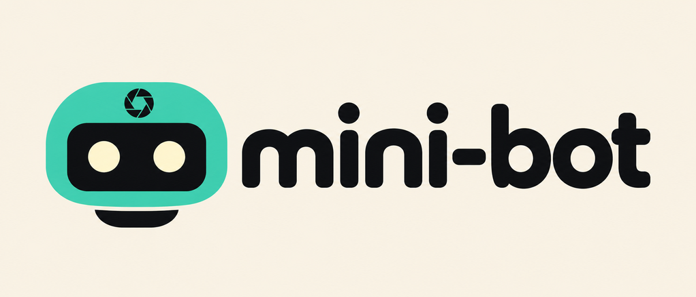
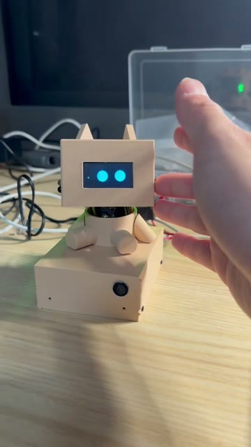

<p align="center">
  
</p>

**mini-bot 是一台用 ESP32-S3 驱动的桌面机器人。它能听你说话，也会用眼睛表情和头部动作回应；接入 LLaVA-OneVision-2.5 后，还能看懂眼前的画面，回看刚才发生的事。**

这是一个开源实验项目，不是量产成品。我们想验证两件事：ESP32 能否稳定连接云端，支撑日常语音和动作互动；[LLaVA-OneVision-2.5](https://github.com/EvolvingLMMs-Lab/LLaVA-OneVision-2.5) 接上真实摄像头后，能看懂什么、哪里容易看错。

[看实机演示](#实机演示) · [了解机器人能做什么](#机器人还能做什么) · [开始接入](#平台设备接入)

```text
麦克风 / 触摸 / 红外 ── ESP32-S3 ── 云端机器人「大脑」
扬声器 / OLED / 舵机 ────┘                 │
摄像头 ────────── ESP32-S3 ── 视觉网关 / LLaVA-OV-2.5
```

## 实机演示

**基础演示1**（约 42 秒）

<a href="https://github.com/kevinluosl/mini-bot/raw/refs/heads/main/docs/demos/basic-demo-01.mp4"></a>

[观看或下载 MP4](https://github.com/kevinluosl/mini-bot/raw/refs/heads/main/docs/demos/basic-demo-01.mp4)

## 重点实验：LLaVA-OV-2.5 视觉

**天下武功，唯快不破。** 对机器人来说，看得准还不够：你举起一个杯子问它「这是什么」，回答最好在杯子还举着的时候就到。我们想要一个适合端侧部署的多模态模型：画面理解效果好、响应快、模型体积小，还能处理实时视频流，而不只是看一张截图。**LLaVA-OneVision-2.5 恰好符合这些选型需求**，所以我们选它来验证机器人能不能一边看、一边跟人自然互动。

在 mini-bot 上，OV-2.5 运行在视觉网关，而不是 ESP32 上。开启观察后，固件通过 HTTPS 每秒上传一张 JPEG；新版网关每秒接收一帧，建会话参数 `fps=30` 表示摄像头的原始帧率，并非上传帧率。**持续观察不等于持续解说**：单次看图按需提问；只有显式开启监控提醒后，才会在条件命中时主动播报。停止观察会关闭会话并同时停用监控。

| 能力 | 实验方式 |
| --- | --- |
| **看当前画面** | 举起手里的东西问「这是什么？」或者问「我在做什么？」让它根据眼前的画面回答。 |
| **回看最近片段** | 把东西放下后再问「我刚才做了什么？」它会根据观察会话中最近约一分钟的画面回答，而不是用最新一张图猜测过去。 |
| **监控提醒** | 说「看到有人喝水就提醒我」；它会开启观察并持续等命中，默认不播报明确否定。说「停止监控提醒」只取消提醒，仍可看当前或回看。 |
| **从看见到互动** | 它会用口语回答，也可以配合眼睛表情和头部动作。回看时画面里没人，可以不出声。 |

在[测试平台控制台](http://43.142.28.216:8765/admin?tab=tools)选中设备，进入「管理任务」，可直接启停「持续观察」和「监控提醒」。这是两个实时开关，不设周期、不可删除，和语音控制共用设备状态。`self.get_device_status` 的 `camera` 区段可查询开关、监控条件和网关就绪状态。监控保持启用直到主动停用或设备重启；普通看当前、回看不会停用监控。新产生的监控结果在后台摘要中附有 OV 会话 ID，包括静默结果；ID 不会播报。

我们重点观察：人物和活动有没有看错，回看能否把前后动作分清，遮挡、逆光、快速运动时是否会乱猜，以及从提问到开口要等多久。情绪描述只是基于画面的推测，不当作事实。

**获取 OV-2.5 视觉接口：**扫描[开发者交流群二维码](#机器人测试服务与开发者群)加入群聊，在群内获取接口文档、HTTPS 网关地址和 API Key。

拿到接入信息后，在 Git 忽略的 `sdkconfig.local.defaults` 中为自己的板子配置：

```ini
CONFIG_MINI_BOT_OV_BASE_URL="https://<网关地址>:<端口>"
CONFIG_MINI_BOT_OV_API_KEY="<服务方分配的 API Key>"
```

已有 `sdkconfig` 时，先备份其中需要保留的本地设置，再重新生成配置并按本文命令构建。固件内置已核验的网关公开证书并验证服务端身份，不允许明文回退。网关证书更新后需核对新指纹、替换 `main/ov_gateway_cert.pem` 并重编。公开默认配置不带网关地址和 Key，**不要提交 Key，也不要分发包含私人 Key 的固件**。

## 机器人还能做什么

- **边聊边回应**：用中文唤醒词叫醒 mini-bot 后就能自然对话。它不只会说话，也会根据聊天内容主动配上眼睛表情和头部动作，比如听到好消息时露出笑眼，或在表示赞同时点点头，不用你另下指令。
- **听指令，也会回应触碰**：你可以让它看向左边、点头、摇头或张望。摸摸它的头会露出笑眼；从侧边靠近也能通过红外传感器触发转头和回应。
- **用眼睛表达**：内置 **7 种 OLED 眼睛效果**——开心、低落、生气、哭泣、专注、惊讶和音乐双音符。眼睛还会随待机、聆听和说话状态变化。
- **点歌，也能帮你记事**：测试服务开启相应功能后，你可以点一首歌、让它记住一条偏好，或设置喝水提醒。播放歌曲时，眼睛会亮起跳动的双音符，它也会不时点头、摇头或摇摆。
- **一起看看眼前和刚才**：接入视觉网关并开启观察后，可以问「我手里拿的是什么？」也可以事后问「我刚才做了什么？」

### 板端工具：机器人本体能做什么

mini-bot 固件默认注册 **9 个板端工具**。工具由机器人在对话中调用，人直接说表里的例句即可。视觉工具需要先配置 LLaVA-OneVision-2.5 视觉网关；「看现在」和「回看刚才」还要求观察会话已开启。

| 工具 | 能做什么 | 可以这样说 |
| --- | --- | --- |
| `self.get_device_status` | 读取扬声器音量、Wi-Fi 信号，以及持续观察和监控提醒状态。 | 「监控提醒开着吗？」 |
| `self.audio_speaker.set_volume` | 把扬声器音量设为 0–100；设为 0 可静音。 | 「把音量调到 30。」 |
| `self.head.act` | 控制双舵机转向、回正或执行动作，自动配合 OLED 表情，可以边说边做。有普通（默认）和使劲两档。 | 「先看左上，再使劲点个头。」 |
| `self.camera.start_watch` | 开启持续观察，当前固件以约 1 帧/秒向视觉网关上传画面，开始积累回看素材。开启本身不会自动播报画面。 | 「开始观察。」 |
| `self.camera.stop_watch` | 停止上传，关闭观察会话，同时停用监控。 | 「不用看了，关上眼睛吧。」 |
| `self.camera.start_monitor` | 按指定条件持续提醒，按需自动开启观察；默认对明确否定保持静默。 | 「看到有人喝水就提醒我。」 |
| `self.camera.stop_monitor` | 停用监控提醒，保留持续观察和回看素材。 | 「停止监控提醒。」 |
| `self.camera.look_current` | 看当前画面。可以带上具体问题，比如识别手里的东西、看它的位置或描述正在做的动作；不指定问题时简述当前画面。 | 「我手里拿着什么？」 |
| `self.camera.look_past` | 根据当前观察会话中最近约一分钟的画面，总结镜头前的人刚才在做什么。只回看已经采集到的画面；可按需开启无人静默或否定静默。 | 「我刚才在做什么？」 |

`self.head.act` 支持 **25 种指令**，不是 25 个独立工具：

- **朝向控制**：看左、右、上、下和四个斜方向，转过去后保持；也可以回正，或立即停止并回正。
- **互动动作**：点头、摇头、张望、好奇、思考、害羞、低落、开心、惊讶、鞠躬致谢、犯困、摇摆、倾听、生气、垂头抽泣。动作做完回到原朝向，表情随动作切换；播放音乐时仍保留双音符眼睛。

### 云端工具：机器人通过平台能做什么

当前服务端内置 **4 个云端工具**。实际可用项取决于设备的配置和服务开通情况，不计入上面的 9 个板端工具。

| 工具 | 能做什么 | 可以这样说 |
| --- | --- | --- |
| `cloud.web_search` | 联网查天气、新闻、赛事、价格等时效信息。通常读取搜索摘要，信息不足时可取网页正文辅助回答；需要平台配置搜索凭据。 | 「帮我查一下深圳明天的天气。」 |
| `cloud.memory` | 按明确指令保存长期信息，或按关键词删除已有记忆。记忆保存在服务端，按设备隔离，可在后续对话中使用。 | 「记住我喜欢喝无糖咖啡。」「忘掉关于咖啡的记忆。」 |
| `cloud.schedule` | 新建、查询和删除定时任务。支持指定时间只执行一次、按间隔、每天或每周执行。到点既可以语音提醒，也能直接调用已注册且可用的板端或云端工具。 | 「每天早上八点提醒我喝水。」「每周一早上九点查一下天气。」「我设了哪些提醒？」 |
| `cloud.music` | 按歌名、歌手或风格搜索并播放可播曲目，也能停止当前播放。歌曲由服务端推流到机器人，实际曲目取决于音源。 | 「放一首轻音乐。」「停止播放。」 |

### 怎么添加自己的工具

- **加板端工具**：适合读传感器、开一盏灯或控制自制外设。在板级代码里用 `McpServer::AddTool(...)` 注册工具，写清用途和参数，把回调接到实际硬件。重新编译烧录后，设备会在连接时上报新工具，机器人就能在对话中调用。
- **加云端工具**：适合查日历、查家里设备状态或调用自己的业务 API。在自建服务端定义工具名称、用途和参数，注册处理函数，再把工具加入对应设备的可用列表。不需要重刷固件；公共测试平台目前未开放自定义云端工具入口。

## 硬件

| 部件 | 选型 |
| --- | --- |
| 主控 | ESP32-S3-CAM 核心开发板 N16R8（16 MB Flash / 8 MB PSRAM） |
| 摄像头 | ESP32-S3 相机模块，**OV2640、160° 广角、75 mm 加长排线** |
| 屏幕 | 1.3 英寸 SH1106 128×64 I²C 单色 OLED |
| 音频 | I²S 麦克风、I²S 功放和扬声器 |
| 动作与传感器 | 两路舵机、电容触摸模块、左右红外模块 |
| 外壳 | 使用瓦楞机器人的 3D 打印外壳 |

接线以 `main/boards/` 下的板级 `config.h` 为准。舵机用独立电源，与主控共地；传感器信号使用 3.3 V 逻辑。

## 构建固件

安装 ESP-IDF 6.0.1 或以上版本，并使用其专用 Python 环境。首次构建由 ESP-IDF Component Manager 按 `dependencies.lock` 获取第三方依赖。

```bash
git clone https://github.com/kevinluosl/mini-bot.git
cd mini-bot
source "$HOME/esp/esp-idf/export.sh"  # 按实际安装路径调整
python3 scripts/build.py mini-bot --name mini-bot \
  --language zh-CN --wake-word wn9_xiaomingtongxue_tts2
python3 -B -m unittest discover -s scripts/tests
python3 -B verify_startup.py
```

固件和唤醒资源在 `build/` 下，烧录地址以 `build/flash_args` 为准。构建脚本不会自动烧录；`verify_startup.py` 只做静态检查，不代替上板测试。

本仓库包含完整的固件项目源码（`main/`、`components/`）、分区配置、构建脚本和测试。为实现上述实验目标，我们重新实现了机器人侧的视觉、互动与云端连接逻辑，也重写了配套测试服务；**本仓库不包含服务端源码**。

## 平台设备接入

- [mini-bot 设备接入指南](docs/server-api.md)：Wi-Fi 配网、六位码绑定、板端 OTA 与 MQTT/UDP、语音功能验收。
- [测试平台控制台](http://43.142.28.216:8765/admin)：使用测试账号登录，[查看账号获取方式](#机器人测试服务与开发者群)。
- [在线接入指南](http://43.142.28.216:8765/api-reference)：也可从控制台右上角打开。
- 设备 OTA 地址：`http://43.142.28.216:8765/deepbot/ota/`。

## 机器人测试服务与开发者群

- **mini-bot 服务端测试账号**：可添加作者微信 **`kluokluo`** 或扫码入群领取，用于登录测试平台控制台。
- **LLaVA-OV-2.5 视觉接口**：扫描下方二维码加入 **LLaVA-OV-2.5 开发者交流群**，在群内获取接口文档、HTTPS 网关地址和 API Key。视觉网关与机器人测试平台分开配置。


> 这是联网实验项目。开启观察会向配置的服务器发送摄像头图像；请征得画面中人员同意，避免拍摄敏感内容，不用时停止观察。

## 致谢

- 感谢 [小智语音机器人（78/xiaozhi-esp32）](https://github.com/78/xiaozhi-esp32)。语音唤醒、联网和对话链路参考了小智的实现。
- 感谢 [瓦楞机器人](https://wcnucfj0ewmg.feishu.cn/docx/OpqodJBo4oROIfxO8tUcxvzvn5f)。mini-bot 使用了它的 3D 打印外壳，硬件选型也参考了它的方案。
- 感谢[格灵深瞳灵感实验室](https://www.deepglint.com/glintlab)团队开源 [LLaVA-OneVision-2.5](https://github.com/EvolvingLMMs-Lab/LLaVA-OneVision-2.5) 视觉模型。

## 许可证

本仓库采用 [MIT License](LICENSE)。第三方组件按各自的许可证使用。
